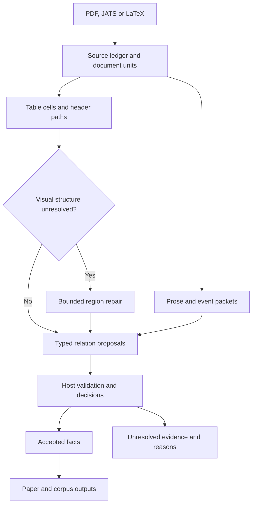

# ResearchIQ: updated scientific extraction architecture

Prepared for Prakash Ravi · 16 October 2026

## Phase 12 execution state — 16 October 2026

- Active implementation branch: `phase-12-new-implementation`.
- Preserved October baseline: `18af9febca88e122b05f6baef7ecbca0068eca4d`.
- Restored `main`: `826d2dadd0b8b6a080830919c4da9aac2ef3112d`; its tracked contents match `c72c80895cf7f8997857d407efe8c6ba49683484`.
- Phase 12 starts from the October checkpoint, not from restored `main`.
- The initial Phase 12 commit adds only `docs/phase12/` documentation. Record its HEAD as `IMPLEMENTATION_START_SHA`; retain the October checkpoint as `BASELINE_SHA` for behavioral comparisons.
- Use the updated prompts in [IMPLEMENTATION_PROMPTS.md](IMPLEMENTATION_PROMPTS.md). Do not rerun the earlier setup prompt that committed/pushed `main`.
- Implementation commits and normal pushes are authorized only on this Phase 12 branch. Changes to `main`, merges and deployments require a separate instruction.
- This specification incorporates an earlier partial-code review. Recheck every proposed defect against the checkpoint's October fixes before editing. Reuse working attribution, deadline, provenance and table code rather than duplicating it solely to match proposed module names.
- Current promotion policy: no degradation in paired uncached p50/p95 at equal or better correct coverage; precision and recall must meet both the stated minimums and the measured baseline. The earlier 20% p95 allowance is superseded.

**Decision:** implement a small, evidence-first extraction path alongside the existing pipeline. Discover evidence across the document, preserve table structure, resolve scientific relationships, validate them, and only then produce result summaries. Use visual repair selectively. Keep full AgenticOCR deployment outside the one-week milestone unless an existing compatible service proves necessary and useful.

This is an implementation specification and research-backed engineering recommendation. It is not a claim that the software has been repaired or that its future accuracy is known. The initial review performed no model inference, corpus evaluation or deployment. Phase 12 setup adds documentation to the new branch; extraction implementation and validation remain to be executed.

## 1. Evidence available and limits of this assessment

The two supplied text files are byte-identical: 32,707 bytes each, SHA-256 `7118d3b1292091055bef5835c16729e2eb12620323ca5a9f292e63b8a28968f1`. They contain the previous review and reported run findings, rather than the underlying run artifacts. They do not independently corroborate one another.

I also read these accessible repository files on 16 October:

| File and branch | What was inspected | Content identity returned by GitHub |
|---|---|---|
| `src/summarization/retrieval_aware.py`, `claude-code-verification` | First 240 lines; selection defaults and content-aware selector | Blob `e2521a6412f761f09fe17553d5fdb165428e0ce7` |
| `src/summarization/summarize.py`, default branch | First 160 lines; extraction prompts and dataset backstops | Blob `4531ffc7ba17d496f9cad37e790afcfd4a347da7` |
| `src/evidence/gate.py`, `exp/phase11-binder` | First 240 lines; gate description and range checks | Branch-scoped inspection; not a current local-worktree audit |
| `src/evidence/borderless.py`, `exp/phase11-binder` | First 145 lines; routing, structural gates and normalization | Blob `0b0cdf57d1b94a58b1832be674ba16af8ac788f9` |

These files come from different branches. Their coexistence in the latest local worktree is not established. The implementer must reconcile the actual local HEAD and uncommitted changes before editing. The full current application and its latest October experiments have not been executed here.

Historical figures in the attachments must remain separate:

| Reported observation | Proper interpretation |
|---|---|
| 3/18 gold claims reached the gate in a 12-paper experiment | Evidence discovery was a major bottleneck in that experiment; not an overall accuracy estimate |
| 0/75 returned items had verified binding in another comparison | A separate binding-policy outcome; do not merge its denominator with 18 |
| Corrected replay: 21 supported outcomes, six complete tuples | Saved-output replay results as described in the supplied review |
| 42 location/year slots: 13 supported non-null, 19 unresolved, 10 inapplicable | Preserve these denominator categories if the replay artifacts confirm them |
| Claimed three-request enrichment pilot | Unsubstantiated without its selection, requests, raw responses, decisions and timing records |

The previous 75% readiness estimate is not an extraction measurement and should not appear as a new validated result.

## 2. Concrete weaknesses and the changes they require

| Failure mechanism | Evidence / qualification | Required change |
|---|---|---|
| Results omitted before binding | Reported 3/18 gate reach; retrieved code caps passages and context | Scan every available document unit for candidate evidence; use retrieval only to enrich a known candidate |
| Equal numbers treated as duplicate evidence | Optional content-aware selector suppresses overlapping numeric-anchor sets and limits a dominant number | Deduplicate by evidence identity and full experimental context, never by score alone |
| Broad extraction mixes discovery, interpretation and writing | Stage 4 prompt requests many prose fields together | Separate candidate discovery, relation proposals, host-built facts and final writing |
| Pressure to fill missing data | Retrieved dataset prompts emphasize mandatory/non-empty extraction | Permit explicit missing/unresolved states; never convert a dataset mention into evidence of use |
| Ordinary scientific tables rejected structurally | Borderless gate requires at least two data rows, limits label length and rejects multiline headers | Represent header hierarchies and merged spans; validate geometry and scope instead of formatting shortcuts |
| Two parsers repeat the same text error | Retrieved Docling/TATR path uses the PDF text layer for both | Treat agreement as diagnostic; preserve shared-source dependency; do not call it independent confirmation |
| Numeric provenance mistaken for correct binding | Gate comments explicitly describe cross-row/count failures | Require the complete value–metric–subject–experiment relation, with source references for each link |
| Metric rules introduce false acceptance/rejection | Experimental gate groups R² with bounded correlations | Use metric-specific definitions and explicit scale; audit the existing range registry |
| Optional context damages a correct measurement | Reported location/year attribution and preservation issues | Validate optional fields independently; enrichment cannot rewrite the accepted measurement |
| Errors can survive into summaries | Multiple output fields contain factual prose | Route every displayed scientific number and ownership claim through the accepted fact store |
| Missing records prevent evaluation claims | Unverified enrichment pilot | Write an append-only run ledger before and during execution |

The R² issue is substantive: the inspected registry uses a finite lower bound. Ordinary predictive R² can be arbitrarily negative, and its unscaled maximum is 1. A generic correlation interval is unsuitable. See the scikit-learn definition [S8]. A range check can flag a transcription problem; passing it never establishes a correct scientific relationship.

## 3. Architecture and stage responsibilities



The repair path can also handle unreadable prose regions. All available pages and structured-source units receive an inventory status before selective interpretation begins. The diagram describes data flow, not an autonomous agent swarm.

Retain acquisition, the existing text model, API and UI. Keep embeddings for search and optional context retrieval. A first scientific extraction must no longer depend on top-k embedding retrieval exposing every result. Preserve existing nonnumeric field support, but do not allow an old results string to bypass the new policy.

Use ordinary Python modules, typed records and JSONL/SQLite artifacts. A graph database, new orchestration framework, model fine-tuning and a new vector store are unnecessary for this milestone.

### 3.1 Source ledger and document units

Assign immutable identities to the input bytes, representation version, page/block and extraction configuration. Store original text separately from normalized text, with a reversible offset map.

Each evidence reference records:

- Source hash, paper ID, representation ID and parser version/configuration hash.
- Evidence ID and type: native text, OCR text, table cell, caption, footnote or structured-source node.
- For PDF evidence: page index, dimensions, coordinate convention, bounding box and raw text/token IDs.
- For JATS/LaTeX: source file hash and node/path/span references. Do not invent PDF coordinates when alignment is unavailable.
- For visual repair: crop/image hash, rendering scale, rotation and transform back to the original page.

Prefer usable structured source for its relationships when it is demonstrably the matching paper version. PDF, arXiv source and published JATS may represent different revisions. Keep them separate until identity/version agreement is established; conflicting values remain separate observations.

### 3.2 Coverage before interpretation

Inventory every available page and relevant structured-source unit. Build candidates from all tables, captions, outcome-bearing prose, and surrounding experimental descriptions. Include abstract, discussion and supplied appendices; a result may occur outside a section named Results. Record unavailable supplements as unavailable.

Numeric scanning is a candidate generator, not a result classifier. Preserve counts, dates, confidence intervals, p-values and citation tokens until their roles are classified. A number is not automatically a score. Nonnumeric outcome statements also need a passage-level extraction path so existing qualitative results are not silently lost.

Each candidate reaches an auditable terminal processing state: processed, rejected with reason, unresolved, or deferred by budget. A document with deferred candidates is partial. Do not label an unread region as containing no results.

Repeated `0.87` values in different cells are distinct evidence. Merge duplicate reporting only after subject, metric, dataset, split, condition, statistic and ownership agree; retain every source reference. A distinct experiment is never removed merely because its number matches another.

### 3.3 Table structure and facts

Preserve the table as a cell graph/grid before producing text or Markdown. Minimum table metadata:

| Record | Required information |
|---|---|
| Table | Source/version, caption, page segments, bounding boxes, parser and status |
| Cell | ID, row/column start, row/column span, raw text, source tokens, location |
| Header relationship | Ordered row-header and column-header paths, plus supporting cell IDs |
| Scope | Dataset, split, class/subgroup, experimental condition, units and statistic |
| Notes | Footnote marker, footnote text and exact affected cells/rows/columns |
| Continuation | Explicit linkage between table segments; repeated-header evidence |

Support transposed tables: methods can occupy columns and metrics can occupy rows. Do not hardcode that the first column is always the method or that the first row contains the complete header. A blank cell, a missing value, zero and a covered merged-cell slot are different states.

Interpret shared headers/captions once per table or table segment. Then construct row/cell facts in host code. This avoids one LLM call per cell. A large table can be processed in row batches while carrying its complete header tree and applicable notes into each batch.

For a difficult table, choose a single existing structure backend first. Docling documents accurate/fast modes and a cell-matching option that can address merged columns [S2]. Compare a second configuration only for a diagnosed defect. Do not run two heavy parsers on every page.

Region isolation is an implementation detail that must be tested: if the installed adapter only processes pages, invoke it on the selected page or a temporary cropped document/image and preserve the coordinate transform. Do not assume a nonexistent region API.

Validate token-to-cell ownership using token identities and geometry, not just matching text strings. Every data token should have an assignment or explicit exclusion reason. Native-text coverage is only a check against the native layer; it cannot prove that all visible image text was extracted. OCR-only regions need their own evidence and quality assessment.

For unresolved grids, quarantine the affected scope. Correct regions may survive if their headers and notes are independently resolved; never publish an arbitrary full grid because it has the expected number of columns.

### 3.4 Prose and study/event attribution

Build an evidence packet containing the measurement clause, paragraph, relevant citation scope and limited explicitly linked context. Give every passage and entity mention an ID.

Use the existing LLM to propose relations among supplied IDs. Expand a packet only to answer a diagnosed missing relationship: for example, the antecedent of “this trial,” the definition of a dataset, or the caption of an explicitly referenced table. A bounded link search is preferable to indiscriminately increasing context.

Distinguish these concepts:

- **Reporting paper:** the document containing the statement.
- **Measurement origin:** current paper, a named cited source, or unresolved.
- **Method origin:** who introduced the method; this can differ from who measured its score.
- **Experiment/event:** the specific evaluation, deployment, population or trial.
- **Modality:** observed result, forecast/projection, hypothesis, recommendation or negated statement.

A baseline model evaluated by the current authors is a current-paper measurement even if the model has a citation. A reproduced literature score in the same table may belong to a cited study. Neither “our table” nor a nearby citation alone resolves this distinction.

Location and year attach to an event, never to the nearest number or organization mention. Publication year, survey year, deployment year and institution address are separate roles. For the supplied FieldView example, a nearby survey's year must not fill the Brazil deployment's unstated year. The reported missing Corteva bridge must leave that relationship unresolved.

Handle respectively by aligned entity/outcome sequences with matching scope. Preserve negation, comparator direction, ranges and projection status. If two interpretations remain plausible, retain the alternatives and abstain on the disputed relationship.

## 4. Claim contract and acceptance policy

Separate the model's proposal from the host's accepted fact. The model cannot assign `accepted`, `verified`, a source hash or an authoritative value.

An illustrative proposal contains pointers only; these IDs are examples, not extracted paper data:

```json
{
  "packet_id": "example_packet",
  "proposals": [
    {
      "measurement_evidence_id": "example_table:r4:c3",
      "subject_evidence_ids": ["example_table:r4:c0"],
      "metric_evidence_ids": ["example_table:r0:c3"],
      "context_evidence_ids": ["example_table:caption"],
      "ownership_evidence_ids": [],
      "relation": "reported_result"
    }
  ]
}
```

The host loads the referenced evidence and builds the fact. The missing ownership evidence in this example must not silently become `own_paper`.

| Fact field | Contract |
|---|---|
| Identity | Claim ID includes source/representation identity and evidence lineage; row numbering alone is insufficient |
| Scientific subject | Method/model/intervention/population as appropriate, with evidence |
| Experimental scope | Task, dataset, split, subgroup, condition, event and comparator where material |
| Measurement | Raw text; parsed decimal string; unit; scale; comparator; exact/range/approximate/bound type |
| Statistics | Mean/median/etc.; uncertainty value and type; interval bounds; sample size separately |
| Attribution | Reporting source, measurement origin, method origin, citation IDs, modality |
| Field support | Supported, unresolved, inapplicable or contradicted, with evidence/reason per field |
| Processing | Complete/partial/deferred/error, independent of semantic support |
| Decision | Accepted, unresolved or rejected; policy version and reason codes |

Use decimal-safe values. Keep `81.9%` distinct from `81.9` and `0.819` until source-supported scale conversion is available. Preserve `≤`, `±`, confidence intervals, exponent notation and footnote markers. “Up to 40%” is a bound, not an exact 40% observation. A missing dash is not zero. Do not label `±` as standard deviation unless the source defines it.

For the one-week scope, extract reported results. If a derived difference is later needed, store it as a derived fact with its formula and source inputs, never as a quoted measurement.

Acceptance requires all applicable checks:

1. Referenced source objects exist and match the source/configuration identities.
2. The measurement is copied or parsed from its cited evidence without unexplained alteration.
3. The subject, metric and essential experimental context are linked within the same supported scope.
4. Table headers, notes and cell assignments are consistent, or the prose relation has explicit supporting evidence.
5. Units, statistic, qualifier, comparator and modality are preserved.
6. Attribution is supported for the output category in which the fact will appear.
7. No unresolved contradiction affects the core measurement.

Valid JSON and real evidence IDs are necessary but insufficient. A model can choose the wrong existing ID. Optional NLI can flag some contradictions but cannot substitute for a cell relationship or certify every scientific statement. Automated acceptance means “passed this evidence policy”; observed semantic precision still requires independent checking.

Missing optional location/year must not discard a correct core result. Missing dataset/split can be essential if several evaluations make the result ambiguous. Define essential fields by claim type, not by requiring every schema field globally.

Use these example decision reasons: `GRID_UNRESOLVED`, `METRIC_UNRESOLVED`, `SUBJECT_UNRESOLVED`, `OWNERSHIP_UNRESOLVED`, `SCALE_UNRESOLVED`, `SOURCE_CONFLICT`, `QUALIFIER_LOST`, `BUDGET_EXCEEDED`, `INCOMPLETE_RESPONSE`.

Enrichment produces a versioned field update referencing the original claim. It cannot overwrite the measurement, qualifier, condition or source quote. Replacing an earlier incorrect acceptance is allowed only as an explicit correction with evidence; preservation means preserving correct facts, not preserving mistakes.

## 5. Where agentic OCR is justified

AgenticOCR is a query-driven visual evidence module. Its reference implementation supports crop/rotation/OCR and coordinate mapping, and expects several model services [S1]. That makes selective visual recovery relevant, but its reported document-QA gains do not establish ResearchIQ's scientific extraction accuracy or local laptop latency.

The reference template sets a 32B vision-language generator and separate extractor/OCR endpoints [S1b]. This is a reference configuration, not a mandatory model size; even so, copying the whole stack is a poor one-week integration default. The current text-only extraction model does not acquire visual capabilities simply by adding a tool name.

Use the following escalation order:

| Diagnosed failure | Action | What does not justify the action |
|---|---|---|
| Readable text and valid table relationships | Native/structured path | Desire to use an agent |
| Borderless or merged-header structure is unresolved | One targeted structure-repair attempt | Merely having many numbers |
| Missing/corrupt native text or a scan | Targeted OCR using the already available local backend | A semantic ownership disagreement in readable text |
| Cropping/rotation/context selection still prevents recovery | Optional bounded visual agent, if a compatible local service is available | A missing year that the source never states |
| Source lacks evidence or competing readings remain | Unresolved output with preserved evidence | Repeated generation until one answer sounds confident |

A real visual-agent escalation must inspect the crop through a vision-capable service. A deterministic crop/OCR router is useful, but should be described accurately rather than advertised as full AgenticOCR.

The agent's action vocabulary is limited to inspect crop, expand crop, rotate, recognize region, submit structure proposal and stop. It may inspect the table together with headers/caption/footnotes. It may not browse, execute shell commands, change acceptance rules or accept a claim.

Start with two regions per paper and at most two repair actions per region, including retries. Stop when a validated structure is recovered, no new evidence appears, or a budget expires. Persist every action and coordinate transform. If a scan needs most pages OCR'd, classify it as a separate heavy route and report partial coverage when the budget is exhausted.

Enable agentic repair only after a paired comparison on the same diagnosed failures shows more independently correct complete tuples than the fixed OCR route within the latency budget. Compare identical inputs and model/backend versions; include failed and timed-out attempts. If the OCR-only baseline succeeds equally, keep the agent disabled.

## 6. Runtime, caching and security

These are proposed initial controls, not measured performance promises. Day 1 calibrates them once on the actual evaluation machine before the final comparison.

```yaml
scientific_extraction:
  mode: evidence_first_shadow
  candidate_inventory: all_available_units
  semantic_model: existing_local_model
  max_semantic_requests_per_paper: 6  # includes retries
  max_schema_retry_per_packet: 1
  max_explicit_context_hops: 2
  document_deadline_seconds: 120
  visual_repair:
    enabled: true
    agentic_enabled: false
    max_regions_per_paper: 2
    max_actions_per_region: 2
    total_repair_deadline_seconds: 45
  max_concurrent_gpu_jobs: 1
  external_document_transmission: false
```

Bound packet size using the actual model tokenizer and reserve output tokens. Do not treat 9,000 characters as a reliable token budget. Split packets without losing header or event scope. All remaining candidates become deferred if the six-request or time budget is reached; they remain in recall denominators. If this happens often, the scope/budget is inadequate and the completion gate fails.

Use the runtime's supported JSON-schema output plus host validation [S5]. Schema validity improves parseability, not factual correctness. Record truncation/completion reasons. One schema retry shares the original deadline; no open-ended repair loop or silent “JSON salvage” acceptance.

For blocking parsers, use a killable worker process and propagate cancellation through the call chain. A timeout checked only between requests will not stop a hung parser or socket. Close sessions/streams in `finally`; write checkpoints atomically; distinguish interruption from successful empty output.

Maintain separate caches:

- Source/parse: bytes hash + parser, model and configuration versions.
- Repair: source hash + region/transform + image hash + backend version + action specification.
- Relation: packet content/structure hash + prompt/schema/model digest + decoding settings.
- Acceptance: relation result + policy version; revalidate when policy changes.

Cache keys must include changed structured table content, not just flattened text. Do not reuse a partial/deferred artifact as a complete extraction. Cached inference is replay, not a new model call. Log it that way.

Measure cold initialization, uncached extraction and cached reads separately. Measure complete processing time, time to first result, p50, p95, maximum, tokens, model calls, repair frequency, timeouts and memory. On 30 papers p95 is a descriptive tail measurement, not a stable service guarantee. Compare old/new on the same machine, model and corpus; do not compare Kaggle against historical RTX 3050 timings.

Phase 12 acceptance goals: paired uncached end-to-end p50 and p95 no worse than baseline at equal or better correct coverage. The earlier proposed 1.2× p95 allowance is not authorized. These targets can fail. Shorter runs that defer more required results do not count as speed improvements. The 120-second limit bounds waiting; it does not promise complete extraction by that time.

Avoid concurrent GPU residency for embeddings, the language model and visual inference on a 6 GB device. Stage work and measure load/unload costs. OCR and visual fallback remain conditional because native extraction is cheaper; PyMuPDF explicitly recommends determining need and reusing OCR results [S6].

Treat documents as data. Parse LaTeX without executing arbitrary TeX/macros; disable XML external entities; bound archive extraction and reject path traversal. Limit OCR tools to resolved local document IDs and allowed image regions. Keep secrets out of prompts/logs and external transmission off. Do not render untrusted extracted HTML directly in the UI.

## 7. Integration seams

Reconcile exact function names in the current local worktree. These are proposed modules, not a claim that the files already exist:

| Proposed module | Responsibility |
|---|---|
| `src/evidence/v2/contracts.py` | Source, table, packet, relation, fact and decision models |
| `src/evidence/v2/inventory.py` | Full-unit inventory, candidates and coverage accounting |
| `src/evidence/v2/table_facts.py` | Header paths, table scope and deterministic fact construction |
| `src/evidence/v2/prose_facts.py` | Event packets, bounded context and relation proposals |
| `src/evidence/v2/repair.py` | Adapter over existing structure/OCR backends and bounded optional agent |
| `src/evidence/v2/validate.py` | Field checks, ownership, units, contradictions and policy decisions |
| `src/evidence/v2/runner.py` | Deadlines, caches, request accounting and artifacts |
| `src/evaluation/evidence_v2.py` | Paired replay, error taxonomy and acceptance metrics |

Integrate at the existing representation stage before flattening loses cells. Replace numeric discovery in the v2 Stage 4 path; retain the old selector for control and ordinary search. Adapt the evidence gate to consume typed candidates rather than rediscovering a number in generated prose.

Write v2 results to a separate run directory initially. The old path stays available as a control, but never blend its unverified results into accepted v2 output. Once the gates pass, adapt the existing API field names to the accepted fact store.

For numeric output, start with deterministic rendering from accepted records. A prose writer may improve wording later, but may not add a score, comparison, ownership or qualifier not represented in its cited facts. Corpus comparisons group only compatible metric, unit, dataset, split, task and condition records. Incompatible results stay visible in separate groups rather than being ranked together.

Keep narrative overview, author interpretation and verified experimental findings distinguishable. Evidence grounding establishes what a source reports; it does not establish that the paper's scientific conclusion is true.

## 8. Bounded validation and completion gates

Reuse the existing 30-paper corpus, existing binding/preservation fixtures and the reported 18-target set after confirming their sources. Freeze inputs, adjudicated labels, policy, hardware and thresholds before the final run. If the 18 labels change during correction, document the changes and recompute old and new scores against the same corrected labels.

One focused source audit is required: check every previously disputed/changed decision and a preselected sample of unchanged accepted outputs across papers and claim types. Machine-generated labels need source verification. Mutation tests complement this review; they do not measure natural extraction accuracy. Do not infer overall precision by inspecting only changed cases.

| Metric | Definition | Proposed gate |
|---|---|---|
| Candidate recall | Gold targets represented in packets / all eligible gold targets | At least 17/18 if the existing 18-target set is confirmed |
| End-to-end exact-tuple recall | Correct accepted gold tuples / all eligible gold tuples | At least 15/18 on that set; at least max(80%, measured baseline recall) on the adjudicated evaluation set overall |
| Accepted-tuple precision | Correct accepted tuples / adjudicated accepted tuples | At least max(95%, measured baseline precision); label explicitly if this is sample precision |
| Known attribution/binding errors | Accepted wrong-cell, wrong-metric or wrong-study cases in frozen fixtures | Zero |
| Preservation | Correct previously accepted facts retained without altered core meaning | 100%, or individually adjudicated correction of a previously wrong fact |
| Optional context | Correct field additions plus correct unresolved/inapplicable states | No unsupported year/location attachment in known cases |
| Output integrity | Accepted facts survive API/summary serialization accurately | No dropped provenance or unverified numeric bypass |
| Coverage accounting | Every candidate/page status recorded | 100% accounted for; deferred work counted as incomplete |
| Runtime | Paired uncached p50/p95 at the agreed coverage | Targets from Section 6 |

These thresholds are proposed project completion criteria, not literature-derived guarantees or predictions. Do not declare success because one known subset improves. Report results by table/prose, native/OCR, and current/cited-study origin, alongside overall values. Report raw counts and uncertainty; a small selected corpus cannot establish general accuracy on all PDFs.

Precision, recall and abstention must remain separate. A system returning nothing cannot pass recall. A system filling every field with guesses cannot pass precision. Location/year inapplicability must not inflate “recovery.” Duplicate rows, claims and preservation-loss occurrences need separate counts.

Focused fixtures should cover: repeated values with different subjects; multiline and merged headers; one-row and transposed tables; continued tables; footnotes and subgroup scope; counts mistaken for scores; unit/scale changes; R² below −100; respectively; cited versus remeasured baselines; projections and negation; absent context bridges; OCR decimal/sign errors; parser conflicts; and truncated/time-out responses.

Useful mutation checks: swap a header, change the subject, delete an ownership bridge, move a citation, alter a unit, or replace a source hash. The affected relation must change or become unresolved, while unrelated correct facts remain intact. Merely detecting the original number is not a passing check.

Do not loop validation indefinitely. Run focused checks while implementing, then one frozen paired evaluation. Repeat only a failing gate after a specific repair, with the rest of the regression set protecting against collateral damage.

## 9. Seven-day execution plan

| Day | Concrete deliverable | Exit condition |
|---|---|---|
| 1 | Current-worktree inventory, frozen source/target manifest, reproducible baseline and first-failure taxonomy | Every known target failure has an earliest failing stage or explicit unknown; versions and budgets frozen |
| 2 | Shared source/table contracts and full-unit candidate inventory | No score-only deduplication; missing/deferred evidence is visible |
| 3 | Table header/scope resolution, deterministic fact builder and existing parser adapter | Known table cases produce correct typed candidates or specific unresolved reasons |
| 4 | Prose/event attribution, metric-specific checks and field-level acceptance | Wrong-cell/wrong-study/unsupported-context fixtures blocked; correct core facts preserved |
| 5 | Output integration, caching/deadlines and targeted OCR repair | End-to-end fact lineage survives output; repair is enabled only where evidence requires it |
| 6 | Frozen 30-paper paired run and focused independent source audit | Exact precision/recall, preservation, abstention, latency and memory recorded |
| 7 | Gate-specific fixes, necessary replay, final report and freeze | Pass criteria documented, or remaining unsupported classes explicitly reported |

Agentic visual control on Day 5 is optional and contingent on a working service and demonstrated need. Do not let its setup consume the table/attribution work. Fully scanned documents and unresolved complex layouts may remain a bounded limitation if they cannot satisfy accuracy and runtime requirements within the week.

## 10. Run artifacts that prevent unverified success claims

Each run directory should contain `manifest.json`, `coverage.json`, `source_units.jsonl`, `table_structures.jsonl`, `packets.jsonl`, `requests.jsonl`, `raw_responses.jsonl`, `facts.jsonl`, `decisions.jsonl`, `timing.jsonl`, `adjudication.jsonl` and `comparison.json`.

The manifest records code commit plus dirty-diff hash, source hashes, target IDs, feature flags, parser/model versions, prompt/schema hashes, hardware, seeds where supported, budgets and evaluation definitions. Every requested inference has an ID allocated before execution, then a raw response or failure/completion record. Store token counts as unknown when the backend does not provide them; never invent zeros.

The comparison shows stage-by-stage attrition: available source → candidate → interpreted relation → accepted fact → returned output → independently correct output. This locates whether the next problem is acquisition, reading, selection, semantics, policy or serialization.

## 11. Implementation instruction

The authoritative current execution prompts are in [IMPLEMENTATION_PROMPTS.md](IMPLEMENTATION_PROMPTS.md), which supplies the Phase 12 branch and baseline guards. The general implementation guidance below remains subordinate to those guards.

Use the following with the coding agent that can access the current local worktree, together with this specification:

> Implement the ResearchIQ evidence-first extraction path described in this document within the existing project. Begin by reading repository instructions, checking the actual branch/HEAD and uncommitted changes, and locating the current extraction, representation, binding, attribution, output and evaluation modules. Do not assume the public branch matches the latest local experiments.
>
> Preserve unrelated work and frozen artifacts. Create an isolated development branch/worktree when appropriate. Keep v2 behind a feature flag with separate run outputs. Treat the supplied historical metrics as unverified until reproduced from the original artifacts; do not fabricate a missing pilot.
>
> First reproduce the smallest available known failures and identify the earliest failing stage. Then implement source-linked document/table contracts, full-unit candidate accounting, header-aware table facts and event-scoped prose facts. Remove numeric-value-only evidence deduplication in the new discovery path. Do not make top-k summary retrieval a prerequisite for scientific result coverage.
>
> Reuse the current local language model and installed parser adapters. Let the model propose evidence IDs and relations; let host code parse/copy values and decide acceptance. Use per-field support states and metric-specific scale/range rules. Preserve qualifiers, uncertainty, conditions, dataset/split and measurement ownership. Separate method origin from measurement origin. Optional context enrichment must never mutate accepted core measurements.
>
> Add schema-constrained output, bounded context expansion, request/deadline accounting, cancellation, versioned caches and an append-only inference ledger. Exhausted budgets must create visible partial/deferred status, not invented complete results. Do not accept incomplete response fragments by silently salvaging JSON.
>
> Route only diagnosed visual failures to existing structure/OCR backends. Full AgenticOCR installation is outside the default milestone. Add a bounded visual-agent adapter only if a compatible service already works and a paired comparison shows a gain over the fixed repair path. Tools must not have arbitrary network/shell access or authority to accept claims.
>
> Render scientific results from accepted facts and preserve provenance through the API and every summary field. Keep incompatible corpus measurements separate. Do not allow legacy prose or unverified fallbacks into accepted v2 results.
>
> Reuse existing gold and regression fixtures after checking source correctness. Add only tests for demonstrated or material failure modes listed in this specification. Freeze and run the old/new comparison on the same corpus, machine and model. Report candidate recall, exact-tuple recall and precision, ownership errors, preservation, abstention, deferred coverage, model calls, tokens, p50/p95/max runtime and memory. Separate sampled precision from full-set precision and cached replay from new inference.
>
> Continue implementing and resolving concrete failing gates without unnecessary approval stops. At the deadline, produce a precise change summary, reproducible commands, actual results and remaining limitations. Do not claim the milestone is solved unless the frozen acceptance criteria pass. Never convert missing artifacts, unexecuted experiments or model judgments into measured improvements.

## 12. Primary sources and how they informed the design

These sources support specific mechanisms. None validates the unimplemented ResearchIQ design or transfers benchmark accuracy to this corpus. Retrieved 16 October 2026; pin the actual dependency revisions during implementation.

- **[S1] [AgenticOCR official repository](https://github.com/opendatalab/AgenticOCR) and [paper](https://arxiv.org/abs/2602.24134).** Supports query-driven visual evidence recovery and bounded crop/rotation/OCR adaptation. ResearchIQ's exhaustive inventory and acceptance rules are recommendations here, not claims from the paper.
- **[S1b] [AgenticOCR reference configuration](https://github.com/opendatalab/AgenticOCR/blob/main/configs/template.yaml).** Inspected directly; blob `504e422e91204583a9b0aba4c17e5f208036af11`. Establishes the reference multi-service configuration, not a minimum hardware requirement.
- **[S2] [Docling advanced options](https://docling-project.github.io/docling/usage/advanced_options/).** Supports targeted experiments with table-recognition mode and cell matching, plus local model use.
- **[S3] [Microsoft Table Transformer / GriTS](https://github.com/microsoft/table-transformer).** Separates detection/structure evaluation and provides cell topology/location/content metrics. Such metrics are diagnostics; exact scientific tuple correctness remains the project goal.
- **[S4] [ReSel, EMNLP 2022](https://aclanthology.org/2022.emnlp-main.46/).** Scientific relations can span text and tables; retrieving a relevant component and selecting linked entities is useful precedent. No new ReSel training is proposed.
- **[S4b] [Metric-Type Identification for Multi-Level Header Numerical Tables, EACL 2021](https://aclanthology.org/2021.eacl-main.267/).** Supports treating metric identification and multilevel headers/captions as a separate problem from recognizing digits.
- **[S5] [Ollama structured outputs](https://docs.ollama.com/capabilities/structured-outputs).** Documents JSON-schema output and host validation. This addresses response structure, not semantic truth.
- **[S6] [PyMuPDF OCR guidance](https://pymupdf.readthedocs.io/en/latest/recipes-ocr.html).** Supports conditional OCR and reuse of its results.
- **[S7] [OmniDocBench](https://github.com/opendatalab/OmniDocBench).** Separates parsing evaluation for text, tables, formulas and reading order. Its aggregate scores should not be presented as scientific claim accuracy.
- **[S8] [scikit-learn R² definition](https://scikit-learn.org/1.6/modules/generated/sklearn.metrics.r2_score.html).** Supports correcting the bounded-correlation treatment of predictive R².
- **[R1] [ResearchIQ retrieval selector](https://github.com/Prakash-Ravi11/researchgpt-pipeline/blob/claude-code-verification/src/summarization/retrieval_aware.py).** Direct code inspection of selection and numeric-anchor deduplication.
- **[R2] [ResearchIQ Stage 4 extraction](https://github.com/Prakash-Ravi11/researchgpt-pipeline/blob/claude-code-verification/src/summarization/summarize.py).** Direct inspection of the broad field-generation prompts.
- **[R3] [ResearchIQ experimental gate](https://github.com/Prakash-Ravi11/researchgpt-pipeline/blob/exp/phase11-binder/src/evidence/gate.py) and [borderless adapter](https://github.com/Prakash-Ravi11/researchgpt-pipeline/blob/exp/phase11-binder/src/evidence/borderless.py).** Direct, partial-file inspection of the range policy and structural restrictions. Not evidence that this experimental branch is enabled locally.